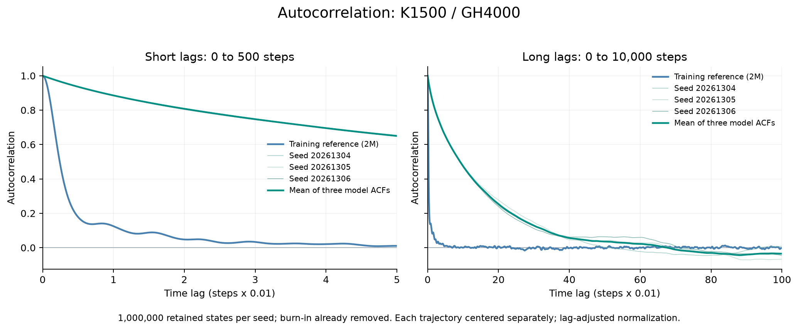
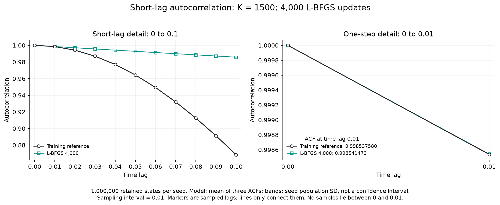

# Memoryless conditional generative modeling: Lorenz–63

Companion computational study for the manuscript *Capabilities and Limits of
Memoryless Conditional Generative Models for Coarse-Grained Dynamics*
(work in progress).

This repository contains a scalar-observation experiment for the Lorenz–63
system: data, a conditional generator, a moment-matching implementation, and
numerical diagnostics. It examines how agreement in state distributions and
adjacent-time joint distributions can coexist with discrepancies in temporal
dependence at longer lags.

[中文实验说明](docs/使用说明.md) · [Training](docs/TRAINING.md) ·
[Evaluation](docs/EVALUATION.md) · [Data](data/README.md) ·
[Numerical consistency](docs/VERIFICATION.md)

## Scientific scope

The model approximates the stationary one-step conditional law of a scalar observation:

```math
K_\Delta(x,\cdot)=\mathrm{Law}(X_{n+1}\mid X_n=x).
```

Iterating the learned conditional law defines a first-order Markov surrogate,
although the observed scalar process need not be Markov.

The manuscript distinguishes the exact conditional kernel from a learned
approximation. Recursion with the exact kernel, initialized from the stationary
marginal, preserves that marginal and the adjacent-time joint law. These exact
identities do not automatically hold for a trained network. The numerical study
therefore evaluates marginal, adjacent-pair, and longer-lag statistics separately.

## Model and objective

Let $(x_i,y_i)$ denote consecutive observations, with $y_i=x_{i+1}$, and let $m_x,s_x$ be the
training-input mean and population standard deviation. The surrogate is

$$
\widehat X_{n+1}=G_\theta\!\left(\frac{\widehat X_n-m_x}{s_x},\varepsilon_n\right),
\qquad \varepsilon_n\overset{\mathrm{iid}}\sim\mathcal N(0,1).
$$

Here $G_\theta$ is a fully connected network with widths $2\to96\to96\to1$
and GELU hidden activations. Its output is the next state in the original units;
there is no residual connection. The implementation accepts an unstandardized
state and performs the input transformation internally.

For $K=1500$ cosine features per coordinate,

$$
\phi_j(x)=\cos(w_j^x x+b_j^x),\qquad
\psi_k(y)=\cos(w_k^y y+b_k^y),
$$

training compares the full cross-moment matrices

$$
M^{\mathrm{data}}_{jk}=\frac1N\sum_{i=1}^N\phi_j(x_i)\psi_k(y_i),
\qquad
M^\theta_{jk}=\frac1N\sum_{i=1}^N\phi_j(x_i)
\mathbb E_\varepsilon\!\left[
\psi_k\!\left(G_\theta\!\left(\frac{x_i-m_x}{s_x},\varepsilon\right)\right)
\right],
$$

with objective

$$
\mathcal L(\theta)=\frac1{K^2}\sum_{j=1}^{K}\sum_{k=1}^{K}
\left(M^\theta_{jk}-M^{\mathrm{data}}_{jk}\right)^2.
$$

The target uses all $N=1,999,999$ adjacent training pairs. The model expectation
is estimated by Monte Carlo during Adam optimization and by fixed weighted
quadrature during L-BFGS optimization.

| Component | Configuration |
| --- | --- |
| Lorenz parameters | $\sigma=10$, $\rho=28$, $\beta=8/3$ |
| Observed coordinate; sampling interval | Scalar $x$; $\Delta=0.01$ |
| Training; validation observations | 2,000,000; 100,000, both after burn-in |
| Network | $2\to96\to96\to1$, GELU |
| Features | 1,500 per coordinate; 2,250,000 cross moments |
| Adam stage | 1,000 updates; 100,000 inputs and 50 noise draws per input per update |
| L-BFGS stage of the supplied model | 4,000 updates with strong-Wolfe line search |
| Fixed quadrature | 586 empirical-input nodes; 128 Gauss–Hermite noise nodes |
| Arithmetic | Float32 network calculations in Adam; float64 in L-BFGS |

Frequencies have distribution $\mathcal N(0,\gamma^{-2})$ and phases are uniform
on $[0,2\pi]$, independently across the two feature banks. The fixed value
$\gamma=0.9954746006464024$ is the median distance between standardized training
inputs. In this experiment, that numerical bandwidth is used directly in
features evaluated on **original state coordinates**. Network-input
standardization and Fourier-feature coordinates are separate conventions.
Initialization, normalization precision, quadrature, and seeds are detailed in
[Training](docs/TRAINING.md) and [the configuration](configs/experiment.json).

## Numerical results

### Optimization


After 1,000 Adam and 4,000 L-BFGS updates, the training objective evaluated with
128 noise nodes is $1.0812081201689768\times10^{-8}$. Monitoring uses 512 noise
nodes and records $1.0810652265454966\times10^{-8}$ on training data and
$2.3470777153673408\times10^{-7}$ on validation data. Monitoring and optimization
values therefore correspond to different integration rules.

### State distributions and adjacent pairs


Three autonomous trajectories each contain 1,100,000 generated states. After
discarding 100,000 states, each retains 1,000,000 states. The reference is the
two-million-point training trajectory.

| Diagnostic | Value |
| --- | ---: |
| Marginal Wasserstein-1, seed 20261304 | 0.1251376568 |
| Marginal Wasserstein-1, seed 20261305 | 0.0533577494 |
| Marginal Wasserstein-1, seed 20261306 | 0.0948549004 |
| Mean of the three marginal distances | 0.09111676885 |
| Observed-input validation: next-state marginal Wasserstein-1 | 0.003923900667 |
| Observed-input validation: increment marginal Wasserstein-1 | 0.02037104593 |

The validation diagnostic conditions on 99,999 observed inputs and draws 32
noise samples per input. This differs from the autonomous sampling protocol.


The joint figure uses a separate continuous trajectory of 2,000,000 retained
states and 1,999,999 adjacent pairs. Bin heights are probability masses.
The state-marginal Wasserstein-1 distance is 0.1705502825. Its inference batch
size differs from the three-trajectory experiment; the two numerical records
are evaluated separately.

### Temporal correlation





Each trajectory is centered and normalized separately. Model autocorrelations
agree closely with the reference at the first sampled lag but decay substantially
more slowly at longer lags. With sampling interval 0.01, the zoom over 0–0.01
contains only lag zero and lag one; connecting lines add no observations.

## Reproduction

Use Python 3.12. From the repository root:

```bash
python -m pip install -r requirements.txt
python scripts/plot_results.py
```

The plotting command reads saved results and writes PNG/PDF figures to
`outputs/figures/`. Full CPU evaluation and GPU training are available through:

```bash
python scripts/evaluate.py --output outputs/evaluation
python scripts/train.py --device cuda --output outputs/training
```

Each run requires a new output directory. CUDA training requires a compatible
PyTorch build; details are given in [Training](docs/TRAINING.md).
The recorded environment is Python 3.12.14, NumPy 2.3.5, SciPy 1.18.1,
PyTorch 2.13.0+cu130, and Matplotlib 3.11.2.

| Location | Contents |
| --- | --- |
| `code/` | Conditional generator, cross-moment objective, and quadrature |
| `configs/experiment.json` | Hyperparameters and random seeds |
| `scripts/train.py` | Two-stage optimization |
| `scripts/evaluate.py` | Autonomous and observed-input diagnostics |
| `scripts/plot_results.py` | Figures from saved numerical results |
| `models/k1500_gh4000.pt` | Model after 1,000 Adam and 4,000 L-BFGS updates |
| `data/` | Training and validation observations |
| `results/` | Metrics, trajectories, and figures |
| `docs/` | Methods, evaluation protocols, and numerical provenance |

Filenames retain the numerical archive identifiers. The number of L-BFGS updates
is distinct from the Gauss–Hermite quadrature order.

## Interpretation

The observed correlation discrepancy is consistent with the manuscript's
distinction between one-step conditional modeling and temporal memory. It does
not isolate memory loss from one-step approximation error or a shift in the
model's long-run marginal distribution.

Validation data were monitored during training, and checkpoint comparison uses
the training reference; neither is an untouched test set. Finite trajectories
and burn-in do not prove stationarity, existence or uniqueness of an invariant
measure, or the manuscript's finite-step contraction assumptions. Numerical
reproducibility is restricted to the configurations documented in
[Numerical consistency](docs/VERIFICATION.md).
