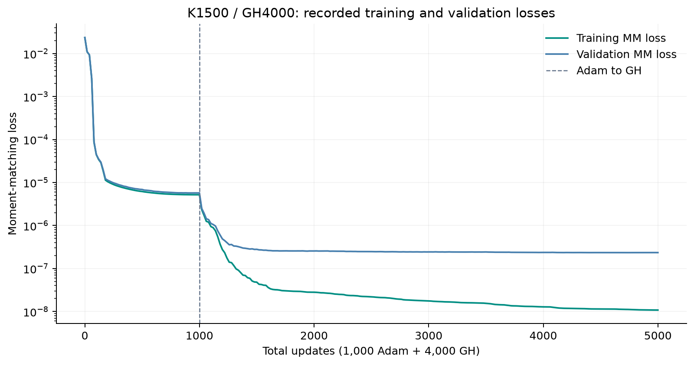
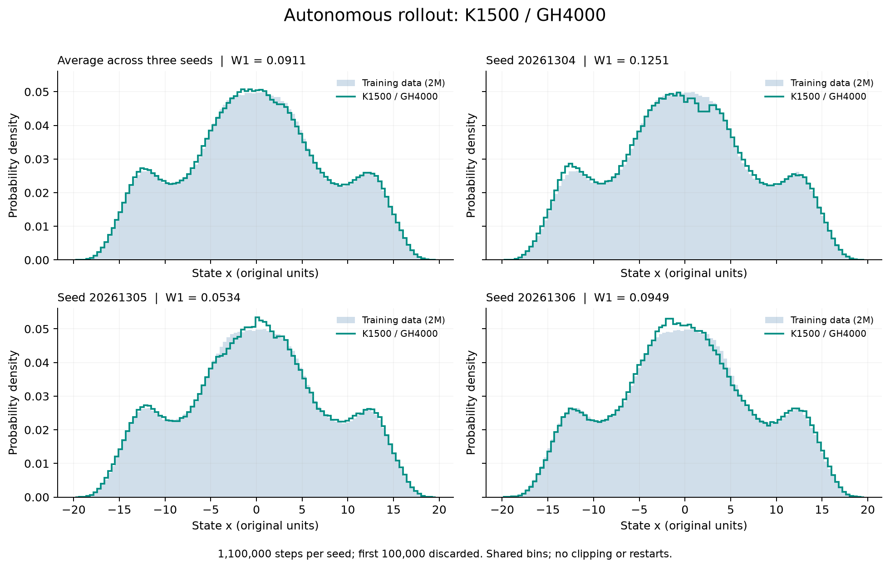
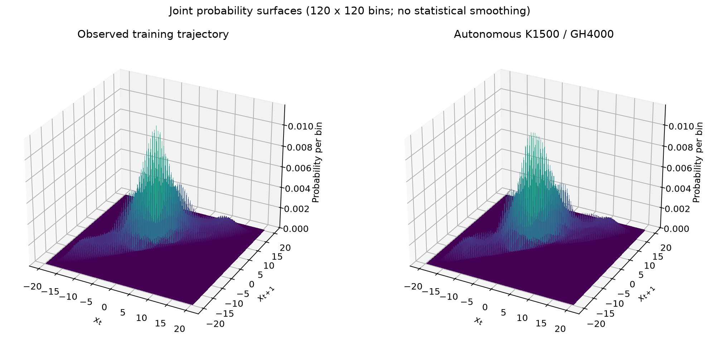

# Lorenz-63: scalar moment matching

A compact research example learning the next scalar Lorenz observation from the current observation and Gaussian noise. This package contains **K=1500, Adam1000 + GH4000** only: readable training code, the saved model, the original data, and selected results.

**GH4000 means 4,000 L-BFGS updates; the Gaussian-Hermite quadrature order is 128.**

The first simplified version reproduced every saved model tensor in a complete fresh retrain. The subsequent cleanup removes file fingerprints and the unused input-mode switch; its numerical comparisons are recorded separately in [verification](docs/VERIFICATION.md).

[中文使用说明](docs/使用说明.md) · [Training](docs/TRAINING.md) · [Evaluation](docs/EVALUATION.md) · [GitHub 中文教程](docs/GITHUB_中文教程.md)

## Results at a glance





| Diagnostic | Saved result |
| --- | ---: |
| Rollout W1 to the 2M training reference, seed 20261304 | 0.1251376568 |
| Rollout W1, seed 20261305 | 0.0533577494 |
| Rollout W1, seed 20261306 | 0.0948549004 |
| Mean of the three per-chain W1 values | **0.09111676885** |
| One-step validation: next-state marginal W1 | 0.003923900667 |
| One-step validation: increment marginal W1 | 0.02037104593 |

Each rollout contains 1,100,000 generated states, with the first 100,000 discarded. The one-step diagnostic uses 99,999 observed validation inputs and 32 Gaussian samples per input. The mean in the table averages three distances; it is not a distance computed from a pooled chain.



The joint figure uses a separate continuous rollout of 2,000,000 retained states and 1,999,999 adjacent pairs. Each grid value is **probability mass per bin**, not a pointwise density. Its state W1 is 0.1705502825. This single-chain experiment has a different inference batch size from the three-chain experiment above; the two archives should not be spliced into one trajectory.

## Run

Use Python 3.12. From the repository folder:

```bash
python -m venv .venv
```

Activate the environment with `.venv\Scripts\activate` on Windows Command Prompt or `source .venv/bin/activate` on macOS/Linux, then:

```bash
python -m pip install -r requirements.txt
python scripts/plot_results.py
python scripts/evaluate.py --steps 1000 --validation-points 1000 --output outputs/quick
```

The short evaluation checks the execution path; its short-run statistics are not the table above. To evaluate the supplied checkpoint with the original full three-chain protocol:

```bash
python scripts/evaluate.py --output outputs/full_evaluation
```

To train from initialization on a CUDA GPU:

```bash
python scripts/train.py --output outputs/retrained
```

Training runs silently and saves its output when finished. Allow roughly 60–90 minutes on the original GPU, excluding environment setup; the complete cleanup verification took about 88 minutes. The supplied model can be evaluated on CPU. A CUDA-enabled PyTorch installation is required for historical GPU training; `requirements.txt` alone does not choose a GPU build. See [the recorded environment and training details](docs/TRAINING.md).

## Method

The generator takes the observed scalar state x and an independent standard Gaussian z. Its MLP has widths 2→96→96→1 with GELU activations. Input x is always standardized inside the model; the output is the next state in original units. There is no input-mode option and no residual connection.

For each coordinate, use 1500 cosine features `cos(omega*x + phase)` with independent frequencies $\omega_j \sim \mathcal{N}(0,\gamma^{-2})$ and uniform phases. The second parameter of this mathematical normal-distribution notation is the variance. In NumPy, `normal(loc=0, scale=1/gamma)` takes the standard deviation, so it implements exactly this variance.

The fixed bandwidth is `gamma=0.9954746006464024`: the median absolute distance over all distinct pairs of standardized training input states `(train_x[:-1] - mean) / std`, using the original float64 mean and population standard deviation. The historical experiment uses this numerical bandwidth directly in the features evaluated on original state coordinates. Only the network input is standardized during training; applying an additional standardization inside the Fourier features would change the experiment. Training minimizes the average squared discrepancy across all 1500×1500 cross moments of observed and generated adjacent pairs. No additional conditional-mean or MSE loss is used.

Both supplied observation arrays already exclude their initial transients. The validation file retains 100,000 points from times 9000.00 through 9999.99 on its historical trajectory; see [data preparation](data/README.md) for the burn-in and split boundaries.

The two training stages are:

1. **Adam, 1000 updates, float32:** 100,000 sampled inputs and 50 Gaussian draws per input, with the archived random streams and cosine learning-rate schedule.
2. **L-BFGS, 4000 updates, float64:** 128-point Gaussian-Hermite integration over noise and 586-node empirical input quadrature. The L-BFGS history persists across all updates.

The model's normalization buffers retain the original float32 rounding when promoted to float64. Replacing them with freshly computed float64 statistics changes the model.

## Files

| Location | Contents |
| --- | --- |
| `scripts/train.py` | Quiet fixed-step training entry point |
| `code/` | Model, moment loss and quadrature mathematics |
| `configs/experiment.json` | One experiment's settings and seeds |
| `scripts/evaluate.py` | CPU rollout and one-step diagnostics |
| `scripts/plot_results.py` | Redraw figures from archived results |
| `models/k1500_gh4000.pt` | Original selected checkpoint |
| `data/` | Exact training and validation observations |
| `results/` | Saved numerical results, loss history and figures |
| `docs/` | Reproduction, provenance and sharing instructions |

New runs write into ignored `outputs/` directories. The original research workspace is preserved separately.

## Interpretation and reproducibility

These are finite numerical experiments on the scalar x observation. They do not establish equality of distributions, exact stationarity, or recovery of the full three-dimensional state. GH4000 is the selected snapshot, not a claim of globally optimal training.

The saved monitoring losses at GH4000 are train `1.0810652265454966e-8` and validation `2.3470777153673408e-7`, evaluated with GH512. The training objective used GH128 and ended at `1.0812081201689768e-8`. Monitoring and optimization losses are not interchangeable. The saved validation quadrature audit passed; this is not a certified bound on every training integration error.

The original checkpoint and observation arrays are copied byte for byte. [Verification](docs/VERIFICATION.md) records which simplified-code comparisons were actually run. Floating-point libraries, hardware, batching and random streams can affect retraining and long trajectories; a matched recipe alone is not evidence of identical final weights.

The original numerical environment was Python 3.12.14, NumPy 2.3.5, SciPy 1.18.1, PyTorch 2.13.0+cu130 and Matplotlib 3.11.2 on Windows 11, with an NVIDIA GeForce RTX 5070 Ti Laptop GPU. The four direct dependencies are pinned in `requirements.txt`; operating system, GPU build and transitive dependencies are not a complete environment lock.

This package is prepared for private academic sharing. No open-source license has been selected.
