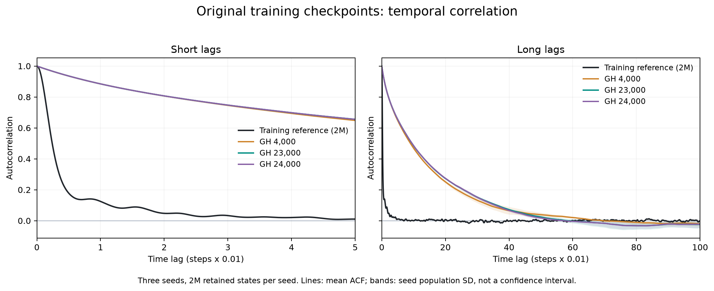
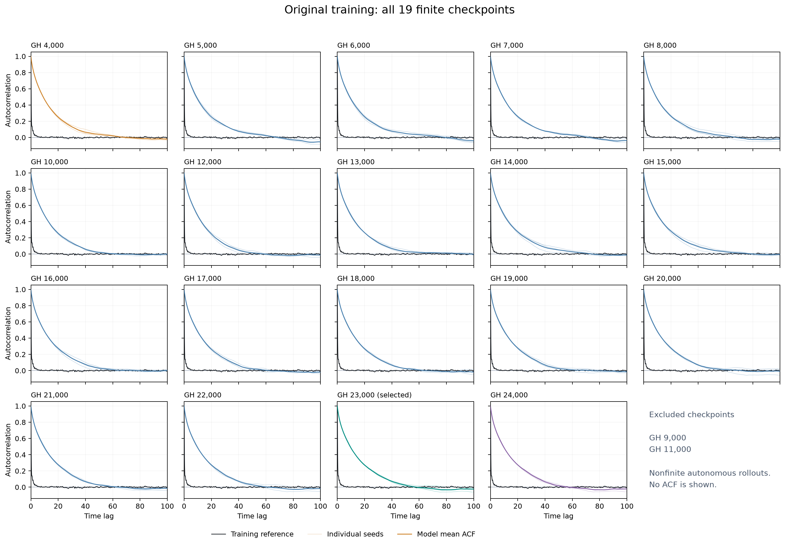

# Autocorrelation supplement: GH4000–GH24000

These curves add a temporal diagnostic to the original K1500 checkpoint scan.
All 21 checkpoints, from 4,000 to 24,000 accepted L-BFGS updates at intervals of
1,000, were evaluated previously. The 19 checkpoints with three finite complete
rollouts are shown here. GH9000 and GH11000 produced nonfinite trajectories and
are excluded entirely, including their remaining finite chains.



**The model correlations decay substantially too slowly.** Near equality at
one lag does not extend to longer lags. The following model values average
the three independently calculated ACF curves:

| Time lag | Steps | Training reference | GH4000 | GH23000 | GH24000 |
| ---: | ---: | ---: | ---: | ---: | ---: |
| 0.01 | 1 | 0.998538 | 0.998533 | 0.998543 | 0.998544 |
| 0.1 | 10 | 0.868545 | 0.985683 | 0.985805 | 0.985808 |
| 1 | 100 | 0.124786 | 0.884514 | 0.884612 | 0.884676 |
| 10 | 1000 | -0.000243 | 0.468897 | 0.484469 | 0.485624 |

GH23000 was selected by the predeclared equal-weight sum of marginal-W1 and
adjacent-joint-JS ranks. ACF is a later diagnostic and does not alter that
selection. That recommendation concerns the two distribution criteria; it
does not mean GH23000 reproduces the temporal dynamics.



## Data and calculation

- Reference: the two million original scalar training observations in
  [`data/train_x.npy`](../../data/train_x.npy), already past the original burn-in.
- Each checkpoint: three autonomous CPU float64 chains, with 2,100,000
  generated states each; discard the first 100,000 and retain all 2,000,000.
- Seeds: `20261304`, `20261305`, `20261306`. The original scan used identical
  starts and paired Gaussian streams across checkpoints. No clipping, resets,
  additional thinning, or fresh rollout was used for this supplement.
- Sample spacing: `0.01`; lags `0..10000` represent times `0..100`.
- Each trajectory has its own sample mean and variance. For a length-n chain,
  use the lag-adjusted estimator

  $$\widehat\rho(k)=\frac{\frac{1}{n-k}\sum_{t=0}^{n-k-1}(x_t-\bar x)(x_{t+k}-\bar x)}{\frac{1}{n}\sum_{t=0}^{n-1}(x_t-\bar x)^2}.$$

  A zero-padded FFT computes the sums. Chains are never concatenated.
  The three ACFs are averaged only after separate normalization. Bands show
  population standard deviation across the three seeds, not a confidence interval.

This is a finite comparison against the training reference, not an independent
test or a proof of stationarity. The main repository's GH4000 figures use the
separately archived three **one-million-state** chains; do not mix those curves
with this **two-million-state-per-chain** scan.

## Saved values and redrawing

[`autocorrelations.npz`](autocorrelations.npz) contains `lag`, `time`,
`reference_acf`, `steps`, `seeds`, `model_acf`, `selected_step`, and
`excluded_steps`. `model_acf` has shape `(19, 3, 10001)`, ordered by the saved
step and seed arrays. The files contain curves, not the full scan trajectories
or additional trained models. The supplied model remains GH4000.

From the repository root:

```bash
python scripts/plot_results.py
```

This redraws the supplied GH4000 results and these supplementary checkpoint
figures into `outputs/figures/`. PNG figures are embedded above; PDF copies are
included for export. The plotting code is in the existing
[`scripts/plot_results.py`](../../scripts/plot_results.py).

The curve archive was calculated on 2026-10-09 from the retained arrays in the
original local `GH24000_checkpoint_scan_20261008` scan. Checkpoints belonged to
the original GH24000 training run, not new retraining. The full local report
retains the source checkpoint paths and computation record. FFT results were
independently compared with direct lag-product sums on the full reference and
GH23000 first chain, including lag 10000; the largest observed difference was
`3.0e-15`.
